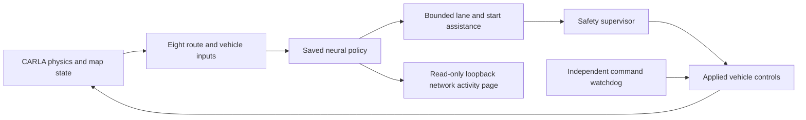

# Driving architecture

The verified everyday setup runs on Device 1:

`app/spawn_car.py` provides the map cockpit. The shared control, policy,
watchdog and safety modules are in `app/`. Map mode owns fixed 0.05-second
physics ticks at up to 20 Hz and uses no RGB cameras. The saved model does
not train during a drive. Manual input cancels the neural route.

The intended two-device design keeps CARLA and final safety enforcement on
Device 1, with Device 2 providing inference and an observer interface.
The prepared `run/run_device2_neural_client.cmd` is an experimental direct
remote client, not a completed Device 1 command gateway. Cross-device
connectivity, host-side stale-command enforcement and remote operation have
not been verified by this reorganization. The existing independent Python
watchdog is local to whichever process runs the driver.

The old camera-oriented architecture diagram is retained in
`docs/archive/device_architecture-Finish-R1.md` as historical context.
