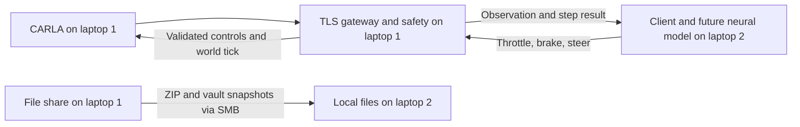

# Architecture

## Live inference path

1. Laptop 2 authenticates to laptop 1 using paired TLS and its client token.
2. `RemoteEnvironment.reset()` returns an initial observation and episode info.
3. A future model adapter converts that observation into model inputs and runs inference.
4. `RemoteEnvironment.step(action)` sends throttle, brake and steering.
5. Laptop 1 validates the action, applies safety guards and advances CARLA.
6. The reply contains the next observation, reward, terminal flags and info.

One client controls the simulator and one request may be outstanding. Laptop 1
alone owns synchronous ticks. File sharing is for packages and knowledge snapshots;
live inference uses TCP 8765 and the existing reset/step protocol.

## Modules

| Path within application | Responsibility |
| --- | --- |
| Laptop 1 `src/sim_host/gateway.py` | Session and request handling |
| Laptop 1 `src/sim_host/transport.py` and `wire.py` | TLS, addresses and message validation |
| Laptop 1 `src/sim_host/environment.py` | Episode/action contract and guards |
| Laptop 1 `src/sim_host/carla_backend.py` and `world.py` | CARLA adapter and world management |
| Laptop 2 `src/rl_client/client.py` | `RemoteEnvironment` client and observation validation |
| Laptop 2 `src/rl_client/transport.py` and `wire.py` | Independent transport implementation |
| Laptop 2 `probe.py`, `diagnose.py`, `connect.cmd` | No-training connection diagnostics |
| Root `build_handoff.py`, `verify_handoff.py` | Portable client packaging and verification |

The trainer, model adapter and framework wrappers remain pending. The vault
documents their intended relationship; it does not implement them.

The one-laptop legacy cockpit handoff is tracked in
[[Three-Camera-Neural-Driving-Handoff]]. It does not change this client's
source or the laptop 1 gateway contract.

