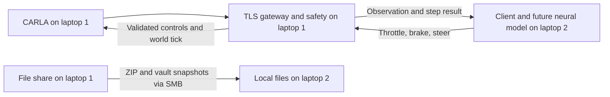

# Architecture

## Live inference path

The one-laptop legacy application also has `run_graphics_neural.cmd`: its saved
state-input policy, destination map, local activity page, Epic rendered cockpit,
and final safety supervisor run on laptop 1. This path is separate from the
future two-laptop RL gateway.

Updated 2026-10-01: the legacy `app/telemetry/neural_visualizer.html` page renders
the real 8/24/16/3 network with labeled values, weighted connections, a vehicle
control schematic and a recent control timeline. It reads the existing loopback
`/state` endpoint. All legacy neural launchers use this same page.

The legacy `run_large_map_neural.cmd` applies the same path to Town13 using the
existing route-conditioned policy and website. It keeps the applications
independent; the legacy client applies Town13 tile streaming, nearby warm-up,
and a coarser whole-town route graph locally.

Updated 2026-10-06: the legacy three-camera cockpit (`run_graphics_neural.cmd`,
`run_large_map_neural.cmd`) runs an offscreen Epic CARLA server on **DX12** and ticks it
synchronously at 15 Hz from the cockpit (DX11 hangs on any RGB camera on this PC). Front
320x180 and left/right 256x144 feeds are display only; the policy still reads just its eight
state features. Layout and drawing live in `app/cockpit/hud.py`, route-start alignment in
`app/cockpit/navigation.py`, and keyboard/diagnostic input in `app/cockpit/viewport_input.py`.
Status, evidence and open items: [[Three-Camera-Neural-Driving-Handoff]]. This work stays
inside `legacy run/` and does not change the laptop 1/laptop 2 data path.

1. Laptop 2 authenticates to laptop 1 using paired TLS and its client token.
2. `RemoteEnvironment.reset()` returns an initial observation and episode info.
3. A future model adapter converts that observation into model inputs and runs inference.
4. `RemoteEnvironment.step(action)` sends throttle, brake and steering.
5. Laptop 1 validates the action, applies safety guards and advances CARLA.
6. The reply contains the next observation, reward, terminal flags and info.

One client controls the simulator and one request may be outstanding. Laptop 1
alone owns synchronous ticks. File sharing is for packages and knowledge snapshots;
live inference uses TCP 8765 and the existing reset/step protocol.

## Modules

| Path within application | Responsibility |
| --- | --- |
| Laptop 1 `src/sim_host/gateway.py` | Session and request handling |
| Laptop 1 `src/sim_host/transport.py` and `wire.py` | TLS, addresses and message validation |
| Laptop 1 `src/sim_host/environment.py` | Episode/action contract and guards |
| Laptop 1 `src/sim_host/carla_backend.py` and `world.py` | CARLA adapter and world management |
| Laptop 2 `src/rl_client/client.py` | `RemoteEnvironment` client and observation validation |
| Laptop 2 `src/rl_client/transport.py` and `wire.py` | Independent transport implementation |
| Laptop 2 `probe.py`, `diagnose.py`, `connect.cmd` | No-training connection diagnostics |
| Root `build_handoff.py`, `verify_handoff.py` | Portable client packaging and verification |

The trainer, model adapter and framework wrappers remain pending. The vault
documents their intended relationship; it does not implement them.

